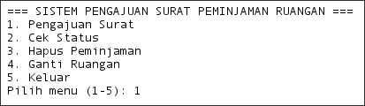
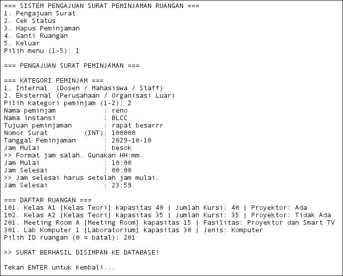
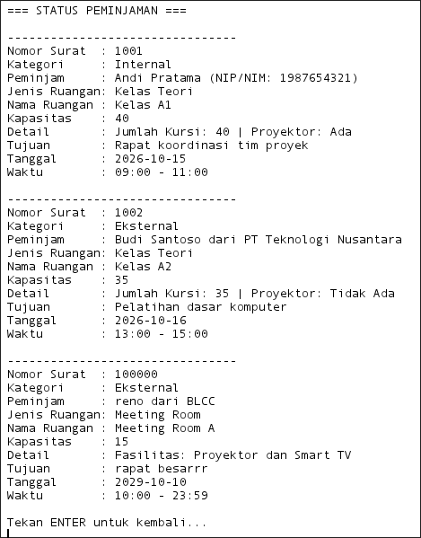
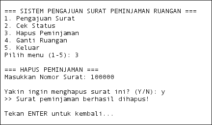
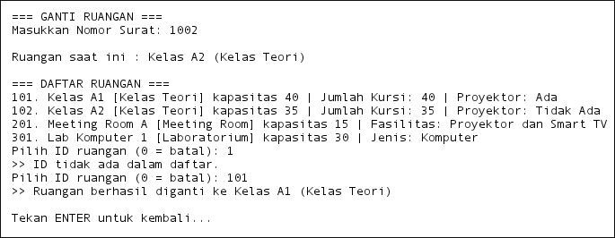
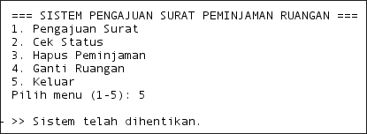
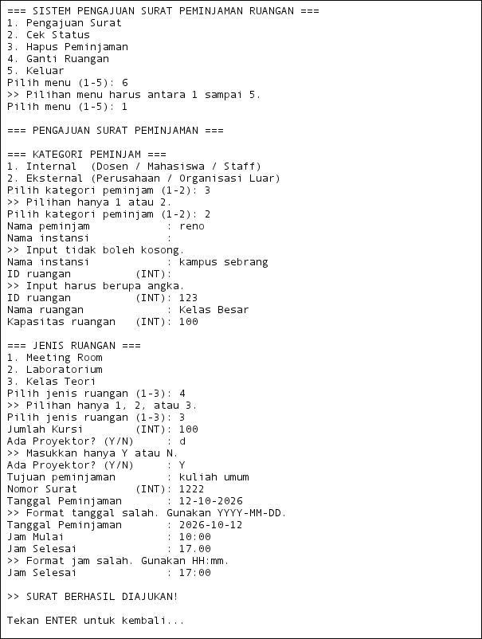

# Sistem Pengajuan Surat Peminjaman Ruangan

Aplikasi **console-based** berbasis Java untuk mengelola pengajuan surat peminjaman ruangan di lingkungan kampus. Program ini dibangun dengan menerapkan konsep **Pemrograman Berorientasi Objek (OOP)** secara penuh — *encapsulation*, *inheritance*, *polymorphism*, dan *abstraction* — serta pola arsitektur **MVC (Model-View-Controller)**. Data disimpan permanen di **MariaDB** melalui **JDBC** dengan pola **DAO (Data Access Object)**.

---

## Daftar Isi

- [Deskripsi Singkat Program](#deskripsi-singkat-program)
- [Struktur Package](#struktur-package)
- [Cara Menjalankan](#cara-menjalankan)
- [Alur Program](#alur-program)
- [Encapsulation dan Inheritance](#encapsulation-dan-inheritance)
- [Polymorphism dan Abstraction](#polymorphism-dan-abstraction)
- [JDBC dan DAO](#jdbc-dan-dao)
- [Validasi Input](#validasi-input)

---

## Deskripsi Singkat Program

Program ini adalah sistem berbasis teks (CLI) yang memungkinkan pengguna mengajukan, melihat, menghapus, dan mengganti ruangan pada surat peminjaman ruangan kampus. Ruangan yang tersedia ada tiga jenis: **Meeting Room**, **Laboratorium**, dan **Kelas Teori**. Ruangan adalah **data master** yang sudah tersimpan di database — pengguna **memilih** ruangan dari daftar, bukan membuatnya saat pengajuan. Pihak peminjam dibagi dua kategori: **Internal** (dosen/mahasiswa/staff) dan **Eksternal** (perusahaan/organisasi luar).

**Fitur utama:**

| No | Menu | Keterangan |
|----|------|------------|
| 1 | Pengajuan Surat | Mengisi data surat dan jadwal, memilih ruangan dari daftar, lalu menyimpan ke database. Jadwal yang bentrok ditolak |
| 2 | Cek Status | Menampilkan seluruh daftar peminjaman yang dimuat ulang dari database |
| 3 | Hapus Peminjaman | Menghapus surat peminjaman berdasarkan nomor surat |
| 4 | Ganti Ruangan | Mengganti ruangan pada peminjaman yang sudah ada, dengan pengecekan bentrok jadwal |
| 5 | Keluar | Menghentikan program |

Program dijalankan dari class `Peminjamanruangan.java` sebagai titik masuk (*entry point*):

```java
public static void main(String[] args) {
    Scanner scanner = new Scanner(System.in);
    try {
        peminjamanView view = new peminjamanView(scanner);
        PeminjamanController controller = new PeminjamanController(view);
        controller.jalankan();
    } catch (IllegalStateException e) {
        System.out.println(">> Aplikasi tidak dapat dijalankan: " + e.getMessage());
        // ...
    } finally {
        scanner.close();
    }
}
```

`main` tidak mengandung logika bisnis — tugasnya hanya merakit objek `View` dan `Controller`, menyerahkan kendali ke `controller.jalankan()`, dan menangkap kegagalan startup (misalnya database mati atau `db.properties` tidak ditemukan) agar pengguna melihat pesan yang jelas, bukan *stack trace*.



---

## Struktur Package

Program disusun menggunakan pola **MVC**, ditambah lapisan **DAO** dan **database** untuk akses data. Setiap lapisan punya tanggung jawab yang jelas dan terpisah.

```
com.mycompany.peminjamanruangan
│
├── Peminjamanruangan.java          ← Entry point (method main)
│
├── model/                          ← MODEL: struktur data & objek bisnis
│   ├── Ruangan.java                   Abstract class (superclass ruangan)
│   ├── MeetingRoom.java               Subclass Ruangan
│   ├── Laboratorium.java              Subclass Ruangan
│   ├── KelasTeori.java                Subclass Ruangan
│   ├── Peminjam.java                  Abstract class (superclass peminjam)
│   ├── PeminjamInternal.java          Subclass Peminjam
│   ├── PeminjamEksternal.java         Subclass Peminjam
│   ├── Jadwal.java                    Data jadwal peminjaman
│   └── Peminjaman.java                Objek surat peminjaman
│
├── View/                           ← VIEW: tampilan & pembacaan input
│   └── peminjamanView.java
│
├── controller/                     ← CONTROLLER: alur & validasi
│   └── PeminjamanController.java
│
├── dao/                            ← DAO: seluruh perintah SQL
│   └── PeminjamanDAO.java
│
└── database/                       ← KONEKSI: akses ke MariaDB
    ├── DatabaseConnection.java        Membuka koneksi JDBC
    └── TestDatabase.java              Uji koneksi secara mandiri

src/main/resources/
├── db.properties                   ← Kredensial database (TIDAK di-commit)
└── db.properties.example           ← Contoh konfigurasi (di-commit)

schema.sql                          ← Skema tabel & data master ruangan
```

### Tanggung Jawab Setiap Package

| Package | Tanggung Jawab |
|---------|----------------|
| `model` | Menyimpan **struktur data** dan **atribut objek**. Tidak berisi logika alur program, tampilan, maupun SQL. |
| `View` | Menangani **semua interaksi dengan pengguna** — menampilkan menu, membaca input, mencetak output ke layar. Tidak menyimpan data. |
| `controller` | Mengatur **alur program dan validasi**. Memanggil `View` untuk input/output dan `dao` untuk penyimpanan. `ArrayList` hanya salinan kerja di memori. **Tidak menulis SQL.** |
| `dao` | Berisi **semua SQL**. Mengubah objek Java menjadi baris tabel dan sebaliknya. |
| `database` | Satu-satunya tempat yang membuka koneksi ke database. Kredensial dibaca dari `db.properties`, tidak ditulis di kode. |

### Diagram Hubungan Antar-Class

```
Peminjamanruangan (main)
    │
    ├──► peminjamanView
    │
    └──► PeminjamanController
              │
              ├──► ArrayList<Peminjaman>   (salinan kerja di memori)
              │         │
              │         ├──► Peminjam (abstract)
              │         │       ├── PeminjamInternal
              │         │       └── PeminjamEksternal
              │         │
              │         ├──► Ruangan (abstract)
              │         │       ├── MeetingRoom
              │         │       ├── Laboratorium
              │         │       └── KelasTeori
              │         │
              │         └──► Jadwal
              │
              └──► PeminjamanDAO ──► DatabaseConnection ──► MariaDB
```

---

## Cara Menjalankan

**Prasyarat:** JDK 21 (dibutuhkan oleh *pattern matching* pada `switch`), Maven, dan MariaDB.

1. **Siapkan database.** Jalankan `schema.sql` di MariaDB. Script ini membuat database `peminjaman_ruangan`, empat tabel, dan data master ruangan.
2. **Siapkan konfigurasi.** Salin `src/main/resources/db.properties.example` menjadi `src/main/resources/db.properties`, lalu isi user dan password database.

   ```properties
   db.url=jdbc:mariadb://localhost:3306/peminjaman_ruangan
   db.user=admin
   db.password=ISI_PASSWORD_ANDA
   ```

3. **Pastikan dependency driver ada di `pom.xml`:**

   ```xml
   <dependency>
       <groupId>org.mariadb.jdbc</groupId>
       <artifactId>mariadb-java-client</artifactId>
       <version>3.5.10</version>
   </dependency>
   ```

4. **(Opsional) Uji koneksi** dengan menjalankan `TestDatabase.java`. Jika berhasil, tercetak `MariaDB connection successful!`.
5. **Clean and Build**, lalu jalankan `Peminjamanruangan.java`.

> `db.properties` berisi password dan sudah dimasukkan ke `.gitignore`. Jangan pernah di-commit.

---

## Alur Program

### Gambaran Umum

1. **Program dijalankan** melalui `main()` di `Peminjamanruangan.java`.
2. Constructor `PeminjamanController` memanggil `dao.findAll()` untuk memuat data peminjaman dari database ke `ArrayList`. Jika database tidak bisa dihubungi, constructor melempar `IllegalStateException` yang ditangkap di `main`.
3. `controller.jalankan()` dipanggil — masuk ke **loop utama** `while(berjalan)` yang terus berjalan selama pengguna belum memilih *Keluar*.
4. Setiap iterasi, menu ditampilkan dan pilihan pengguna dibaca dan divalidasi.
5. `switch` mengarahkan ke salah satu method: `ajukanSurat()`, `tampilkanStatus()`, `hapusSurat()`, `gantiRuangan()`, atau menghentikan loop.
6. Saat pengguna memilih **5 (Keluar)**, flag `berjalan` diset `false`, loop berhenti, `scanner.close()` dipanggil, dan program selesai.

```java
// PeminjamanController.java — constructor
public PeminjamanController(peminjamanView view) {
    this.view = view;
    try {
        daftarPeminjaman.addAll(dao.findAll());
    } catch (SQLException e) {
        throw new IllegalStateException(
                "Gagal memuat data peminjaman dari MariaDB.", e);
    }
}
```

```java
// PeminjamanController.java
public void jalankan() {
    boolean berjalan = true;
    while (berjalan) {
        view.tampilkanMenu();
        switch (view.bacaPilihanMenu()) {
            case 1 -> ajukanSurat();
            case 2 -> tampilkanStatus();
            case 3 -> hapusSurat();
            case 4 -> gantiRuangan();
            case 5 -> {
                berjalan = false;
                view.pesan("\n>> Sistem telah dihentikan.");
            }
        }
    }
}
```

**Prinsip yang dipakai di semua menu:** *database dulu, memori kemudian*. `ArrayList` hanya diubah jika operasi database berhasil, sehingga tampilan dan data tidak bisa tidak sinkron.


---

### Menu 1 — Pengajuan Surat

Pengguna mengisi data secara berurutan: data peminjam, data surat, jadwal, lalu **memilih ruangan dari daftar**. Jadwal diisi *sebelum* memilih ruangan karena pengecekan bentrok membutuhkan keduanya. Jika ruangan yang dipilih sudah dipinjam pada jadwal tersebut, pengguna diminta memilih ruangan lain.

Setelah semua data valid, controller membentuk objek `Peminjam` (Internal/Eksternal) dan `Jadwal`, mengambil objek `Ruangan` dari data master, lalu membungkus ketiganya ke dalam `Peminjaman` baru. Objek ini disimpan ke database lewat `dao.simpan()`, dan baru setelah itu dimasukkan ke `ArrayList`.

```java
// PeminjamanController.java — helper membuat Peminjam (polimorfisme)
private Peminjam buatPeminjam() {
    int kategori = view.pilihKategoriPeminjam();
    String nama  = view.bacaString("Nama peminjam            : ");
    if (kategori == 1) {
        String nip = view.bacaString("NIP / NIM                : ");
        return new PeminjamInternal(nama, nip);
    } else {
        String instansi = view.bacaString("Nama instansi            : ");
        return new PeminjamEksternal(nama, instansi);
    }
}
```

```java
// PeminjamanController.java — memilih ruangan dari data master
private Ruangan pilihRuangan() throws SQLException {
    List<Ruangan> daftar = dao.findAllRuangan();
    if (daftar.isEmpty()) {
        view.pesan(">> Belum ada ruangan terdaftar di database.");
        return null;
    }
    view.tampilkanDaftarRuangan(daftar);
    while (true) {
        int id = view.bacaInt("Pilih ID ruangan (0 = batal): ");
        if (id == 0) return null;
        for (Ruangan r : daftar) {
            if (r.getIdRuangan() == id) return r;
        }
        view.pesan(">> ID tidak ada dalam daftar.");
    }
}
```

```java
// PeminjamanController.java — cek bentrok, lalu simpan
while (true) {
    ruangan = pilihRuangan();
    if (ruangan == null) { /* pengajuan dibatalkan */ return; }
    if (!dao.adaBentrok(ruangan.getIdRuangan(),
            LocalDate.parse(tanggal), jamMulai, jamSelesai, -1)) break;
    view.pesan(">> Ruangan sudah dipinjam pada jadwal tersebut. Pilih ruangan lain.");
}

dao.simpan(peminjaman);              // database dulu
daftarPeminjaman.add(peminjaman);    // memori kemudian
```



---

### Menu 2 — Cek Status

Controller memuat ulang seluruh data dari database (`dao.findAll()`) agar yang tampil selalu data terbaru, lalu meminta `View` mencetak detail setiap `Peminjaman`.

```java
// PeminjamanController.java
private void tampilkanStatus() {
    try {
        daftarPeminjaman.clear();
        daftarPeminjaman.addAll(dao.findAll());

        if (daftarPeminjaman.isEmpty()) {
            view.pesan(">> Belum ada data peminjaman.");
        } else {
            for (Peminjaman p : daftarPeminjaman)
                view.tampilkanStatus(p);
        }
    } catch (SQLException e) {
        view.pesan(">> Gagal mengambil data: " + e.getMessage());
    }
    view.tekanEnter();
}
```

```java
// peminjamanView.java — polimorfisme bekerja di sini saat runtime
public void tampilkanStatus(Peminjaman p) {
    System.out.println("Kategori     : " + p.getPeminjam().getKategori());
    System.out.println("Peminjam     : " + p.getPeminjam().getIdentitas());
    System.out.println("Jenis Ruangan: " + p.getRuangan().getJenisRuangan());
    System.out.println("Detail       : " + p.getRuangan().getDetailRuangan());
    // ...
}
```



---

### Menu 3 — Hapus Peminjaman

Pengguna memasukkan nomor surat. Controller mencari `Peminjaman` yang cocok; jika ditemukan, pengguna diminta konfirmasi `Y/N`. Penghapusan dilakukan di database lebih dulu (`dao.hapus()`), dan `ArrayList` hanya diubah jika database berhasil. Data ruangan **tidak ikut dihapus** karena merupakan data master.

```java
// PeminjamanController.java
private void hapusSurat() {
    int nomor = view.bacaInt("Masukkan Nomor Surat: ");
    Peminjaman p = cariPeminjaman(nomor);

    if (p == null) {
        view.pesan(">> Nomor surat tidak ditemukan.");
    } else if (view.bacaKonfirmasi("\nYakin ingin menghapus surat ini? (Y/N): ")
                   .equalsIgnoreCase("Y")) {
        try {
            if (dao.hapus(nomor)) {
                daftarPeminjaman.remove(p);
                view.pesan(">> Surat peminjaman berhasil dihapus!");
            } else {
                view.pesan(">> Data tidak ditemukan di database.");
            }
        } catch (SQLException e) {
            view.pesan(">> Gagal menghapus data: " + e.getMessage());
        }
    } else {
        view.pesan(">> Penghapusan dibatalkan.");
    }
    view.tekanEnter();
}
```



---

### Menu 4 — Ganti Ruangan

Controller mencari `Peminjaman` berdasarkan nomor surat, menampilkan ruangan saat ini, lalu pengguna memilih ruangan pengganti dari daftar. Sebelum disimpan, sistem memeriksa bahwa ruangan baru bukan ruangan yang sedang dipakai dan **tidak bentrok** dengan peminjaman lain (surat ini dikecualikan dari pengecekan). Perubahan disimpan lewat `dao.gantiRuangan()`, lalu dipasang ke objek `Peminjaman` melalui setter.

```java
// PeminjamanController.java
Ruangan baru = pilihRuangan();

if (baru == null) {
    view.pesan(">> Penggantian ruangan dibatalkan.");
} else if (baru.getIdRuangan() == p.getRuangan().getIdRuangan()) {
    view.pesan(">> Itu adalah ruangan yang sedang dipakai.");
} else if (dao.adaBentrok(baru.getIdRuangan(),
        LocalDate.parse(p.getJadwal().getTanggal()),
        p.getJadwal().getJamMulai(), p.getJadwal().getJamSelesai(),
        p.getNomorSurat())) {
    view.pesan(">> Ruangan tersebut bentrok dengan peminjaman lain.");
} else if (dao.gantiRuangan(p.getNomorSurat(), baru.getIdRuangan())) {
    p.setRuangan(baru);   // memori diubah SETELAH database berhasil
    view.pesan(">> Ruangan berhasil diganti ke " + baru.getNamaRuangan());
}
```



---

### Menu 5 — Keluar

```java
case 5 -> {
    berjalan = false;
    view.pesan("\n>> Sistem telah dihentikan.");
}
```

Flag `berjalan` menjadi `false`, loop `while` berhenti, kendali kembali ke `main()`, `scanner.close()` dipanggil, dan program berakhir.



---

## Encapsulation dan Inheritance

### Encapsulation

**Encapsulation** adalah prinsip menyembunyikan detail internal objek dan hanya mengekspos apa yang diperlukan melalui method yang terkontrol.

Seluruh atribut di semua class model dideklarasikan `private`. Akses ke atribut tersebut hanya bisa dilakukan melalui **getter** dan **setter** `public`.

```java
// model/Ruangan.java
public abstract class Ruangan {
    private int idRuangan;       // tidak bisa diakses langsung dari luar
    private String namaRuangan;
    private int kapasitas;
    private boolean tersedia;

    // Satu-satunya cara membaca nilai dari luar class
    public int getIdRuangan()       { return idRuangan; }
    public String getNamaRuangan()  { return namaRuangan; }
    public int getKapasitas()       { return kapasitas; }
    public boolean isTersedia()     { return tersedia; }

    // Satu-satunya cara mengubah nilai dari luar class
    public void setIdRuangan(int idRuangan)       { this.idRuangan = idRuangan; }
    public void setNamaRuangan(String namaRuangan){ this.namaRuangan = namaRuangan; }
    public void setKapasitas(int kapasitas)       { this.kapasitas = kapasitas; }
    public void setTersedia(boolean tersedia)     { this.tersedia = tersedia; }
    // ...
}
```

```java
// model/Peminjaman.java
public class Peminjaman {
    private Peminjam peminjam;   // private — tidak bisa disentuh langsung dari luar
    private String tujuan;
    private int nomorSurat;
    private Ruangan ruangan;
    private Jadwal jadwal;

    public Peminjam getPeminjam()              { return peminjam; }
    public Ruangan getRuangan()                { return ruangan; }
    public void setRuangan(Ruangan ruangan)    { this.ruangan = ruangan; }
    // ...
}
```

```java
// controller/PeminjamanController.java
private final ArrayList<Peminjaman> daftarPeminjaman = new ArrayList<>();
private final PeminjamanDAO dao = new PeminjamanDAO();
private final peminjamanView view;
// Seluruh field bersifat private final: hanya method di dalam controller ini
// yang bisa menyentuhnya, dan referensinya tidak bisa diganti setelah dibuat.
```

Berkat encapsulation, fitur **Ganti Ruangan** bisa berjalan aman:

```java
p.setRuangan(baru);  // mengganti ruangan lewat setter, bukan akses langsung ke field
```

---

### Inheritance

**Inheritance** (pewarisan) memungkinkan sebuah class mewarisi atribut dan method dari class lain, sehingga kode yang sama tidak perlu ditulis ulang.

Program ini memiliki **dua hierarki inheritance** yang saling independen:

#### Hierarki Ruangan

`Ruangan` sebagai superclass abstrak, dengan tiga subclass konkret.

```java
// model/Ruangan.java — superclass
public abstract class Ruangan {
    private int idRuangan;
    private String namaRuangan;
    private int kapasitas;
    private boolean tersedia;

    public Ruangan(int idRuangan, String namaRuangan, int kapasitas, boolean tersedia) {
        this.idRuangan = idRuangan;
        this.namaRuangan = namaRuangan;
        this.kapasitas = kapasitas;
        this.tersedia = tersedia;
    }
    // getter & setter ...
}
```

```java
// model/MeetingRoom.java — subclass, mewarisi Ruangan
public class MeetingRoom extends Ruangan {
    private String fasilitas;   // atribut tambahan khusus MeetingRoom

    public MeetingRoom(int idRuangan, String namaRuangan, int kapasitas,
                       boolean tersedia, String fasilitas) {
        super(idRuangan, namaRuangan, kapasitas, tersedia); // memanggil constructor Ruangan
        this.fasilitas = fasilitas;
    }
}
```

```java
// model/Laboratorium.java — subclass, mewarisi Ruangan
public class Laboratorium extends Ruangan {
    private String jenisLaboratorium;

    public Laboratorium(int idRuangan, String namaRuangan, int kapasitas,
                        boolean tersedia, String jenisLaboratorium) {
        super(idRuangan, namaRuangan, kapasitas, tersedia);
        this.jenisLaboratorium = jenisLaboratorium;
    }
}
```

```java
// model/KelasTeori.java — subclass ketiga, mewarisi Ruangan
public class KelasTeori extends Ruangan {
    private int jumlahKursi;
    private boolean adaProyektor;

    public KelasTeori(int idRuangan, String namaRuangan, int kapasitas,
                      boolean tersedia, int jumlahKursi, boolean adaProyektor) {
        super(idRuangan, namaRuangan, kapasitas, tersedia);
        this.jumlahKursi = jumlahKursi;
        this.adaProyektor = adaProyektor;
    }
}
```

Kata kunci `extends Ruangan` berarti `MeetingRoom`, `Laboratorium`, dan `KelasTeori` **otomatis memiliki** `idRuangan`, `namaRuangan`, `kapasitas`, `tersedia`, beserta seluruh getter/setter-nya — tanpa menulis ulang. `super(...)` di constructor meneruskan empat parameter umum ke constructor `Ruangan`.

#### Hierarki Peminjam

`Peminjam` sebagai superclass abstrak, dengan dua subclass konkret.

```java
// model/Peminjam.java — superclass
public abstract class Peminjam {
    private String nama;

    public Peminjam(String nama) {
        this.nama = nama;
    }

    public String getNama() { return nama; }
    public void setNama(String nama) { this.nama = nama; }
}
```

```java
// model/PeminjamInternal.java — subclass, mewarisi Peminjam
public class PeminjamInternal extends Peminjam {
    private String nip;   // atribut tambahan khusus peminjam internal

    public PeminjamInternal(String nama, String nip) {
        super(nama);      // memanggil constructor Peminjam
        this.nip = nip;
    }
}
```

```java
// model/PeminjamEksternal.java — subclass, mewarisi Peminjam
public class PeminjamEksternal extends Peminjam {
    private String namaInstansi;

    public PeminjamEksternal(String nama, String namaInstansi) {
        super(nama);
        this.namaInstansi = namaInstansi;
    }
}
```

---

## Polymorphism dan Abstraction

### Abstraction

**Abstraction** adalah prinsip menyembunyikan detail implementasi dan hanya memperlihatkan "kontrak" — apa yang harus bisa dilakukan sebuah objek, bukan bagaimana caranya.

Program ini memiliki **dua abstract class**, masing-masing mendefinisikan abstract method yang **wajib** diimplementasikan oleh subclassnya.

#### Abstract Class `Ruangan`

```java
// model/Ruangan.java
public abstract class Ruangan {
    // ... atribut & constructor ...

    /**
     * Setiap jenis ruangan WAJIB memberikan label jenisnya sendiri.
     * Ruangan tidak bisa diinstansiasi langsung karena belum ada
     * implementasi konkret untuk method ini.
     */
    public abstract String getJenisRuangan();

    /**
     * Setiap jenis ruangan WAJIB mendeskripsikan detailnya sendiri.
     */
    public abstract String getDetailRuangan();
}
```

Karena `Ruangan` bersifat `abstract`, kode berikut akan **gagal dikompilasi**:

```java
Ruangan r = new Ruangan(...); // ERROR — tidak bisa membuat objek dari abstract class
```

Yang benar adalah membuat objek dari subclass konkretnya:

```java
Ruangan r = new MeetingRoom(...);    // OK
Ruangan r = new Laboratorium(...);   // OK
Ruangan r = new KelasTeori(...);     // OK
```

#### Abstract Class `Peminjam`

```java
// model/Peminjam.java
public abstract class Peminjam {
    // ... atribut & constructor ...

    /**
     * Setiap kategori peminjam WAJIB memberikan format identitasnya sendiri.
     */
    public abstract String getIdentitas();

    /**
     * Setiap kategori peminjam WAJIB memberikan label kategorinya sendiri.
     */
    public abstract String getKategori();
}
```

Abstraction memungkinkan `PeminjamanController`, `peminjamanView`, dan `PeminjamanDAO` bekerja dengan tipe umum `Ruangan` dan `Peminjam` tanpa perlu tahu detail subclass yang sesungguhnya — cukup memanggil `getJenisRuangan()` atau `getIdentitas()`, dan implementasi yang tepat akan berjalan secara otomatis.

---

### Polymorphism

**Polymorphism** adalah kemampuan satu referensi bertipe umum untuk menunjuk ke objek dari berbagai subclass, dan memanggil method yang berbeda-beda hasilnya tergantung tipe objek sesungguhnya saat runtime.

#### Polymorphism pada Ruangan

Tiga subclass `Ruangan` masing-masing mengimplementasikan `getJenisRuangan()` dan `getDetailRuangan()` secara berbeda:

```java
// model/MeetingRoom.java
@Override
public String getJenisRuangan() {
    return "Meeting Room";
}

@Override
public String getDetailRuangan() {
    return "Fasilitas: " + fasilitas;
}
```

```java
// model/Laboratorium.java
@Override
public String getJenisRuangan() {
    return "Laboratorium";
}

@Override
public String getDetailRuangan() {
    return "Jenis: " + jenisLaboratorium;
}
```

```java
// model/KelasTeori.java
@Override
public String getJenisRuangan() {
    return "Kelas Teori";
}

@Override
public String getDetailRuangan() {
    return "Jumlah Kursi: " + jumlahKursi
            + " | Proyektor: " + (adaProyektor ? "Ada" : "Tidak Ada");
}
```

#### Polymorphism pada Peminjam

Dua subclass `Peminjam` mengimplementasikan `getIdentitas()` dan `getKategori()` berbeda:

```java
// model/PeminjamInternal.java
@Override
public String getIdentitas() {
    return getNama() + " (NIP/NIM: " + nip + ")";
}

@Override
public String getKategori() {
    return "Internal";
}
```

```java
// model/PeminjamEksternal.java
@Override
public String getIdentitas() {
    return getNama() + " dari " + namaInstansi;
}

@Override
public String getKategori() {
    return "Eksternal";
}
```

#### Polimorfisme saat Runtime di `peminjamanView`

Baris kode pemanggilan **persis sama** untuk semua jenis ruangan maupun semua kategori peminjam — Java yang menentukan implementasi mana yang dijalankan berdasarkan tipe objek sesungguhnya:

```java
// peminjamanView.java — daftar ruangan master
public void tampilkanDaftarRuangan(List<Ruangan> daftar) {
    for (Ruangan r : daftar) {
        System.out.println(r.getIdRuangan() + ". " + r.getNamaRuangan()
                + " [" + r.getJenisRuangan() + "]"      // berbeda per subclass
                + " kapasitas " + r.getKapasitas()
                + " | " + r.getDetailRuangan());        // berbeda per subclass
    }
}
```

```java
// peminjamanView.java — status peminjaman
public void tampilkanStatus(Peminjaman p) {
    // getKategori() → "Internal" atau "Eksternal" tergantung subclass Peminjam
    System.out.println("Kategori     : " + p.getPeminjam().getKategori());

    // getIdentitas() → format berbeda untuk Internal vs Eksternal
    System.out.println("Peminjam     : " + p.getPeminjam().getIdentitas());

    // getJenisRuangan() → "Meeting Room", "Laboratorium", atau "Kelas Teori"
    System.out.println("Jenis Ruangan: " + p.getRuangan().getJenisRuangan());

    // getDetailRuangan() → isi berbeda tergantung jenis ruangan
    System.out.println("Detail       : " + p.getRuangan().getDetailRuangan());
}
```

Ketika data dari database ditampilkan, satu daftar yang sama bisa berisi `MeetingRoom`, `Laboratorium`, dan `KelasTeori` sekaligus, dan **baris kode yang sama** menghasilkan output yang berbeda untuk masing-masing — inilah inti dari polymorphism.

#### Upcasting (menyimpan subclass ke referensi superclass)

Variabel bertipe `Ruangan` dan `Peminjam` bersifat abstrak, namun bisa menampung objek subclass mana pun:

```java
// PeminjamanController.java — buatPeminjam()
// Tipe kembalian Peminjam (abstract), objeknya Internal atau Eksternal
private Peminjam buatPeminjam() {
    // ...
    if (kategori == 1) {
        return new PeminjamInternal(nama, nip);
    } else {
        return new PeminjamEksternal(nama, instansi);
    }
}
```

```java
// PeminjamanDAO.java — mapRuangan()
// Tipe kembalian Ruangan (abstract), objeknya salah satu dari tiga subclass
// tergantung nilai kolom jenis_ruangan di database
return switch (jenis) {
    case "Meeting Room" -> new MeetingRoom(id, nama, kapasitas, tersedia, rs.getString("fasilitas"));
    case "Laboratorium" -> new Laboratorium(id, nama, kapasitas, tersedia, rs.getString("jenis_laboratorium"));
    case "Kelas Teori"  -> new KelasTeori(id, nama, kapasitas, tersedia,
                                          rs.getInt("jumlah_kursi"), rs.getBoolean("ada_proyektor"));
    default -> throw new SQLException("Jenis ruangan tidak dikenal: " + jenis);
};
```

```java
// model/Peminjaman.java — field bertipe abstract class, bukan subclass konkret
private Peminjam peminjam;   // bisa menampung Internal atau Eksternal
private Ruangan ruangan;     // bisa menampung MeetingRoom, Laboratorium, atau KelasTeori
```

---

## JDBC dan DAO

### Apa yang Berubah?

Sebelumnya data hanya disimpan di `ArrayList` sehingga hilang ketika program ditutup. Sekarang data disimpan permanen di **MariaDB** melalui **JDBC** (*Java Database Connectivity*), yaitu API standar Java untuk menjalankan perintah SQL dari kode program. **Database adalah sumber data utama**, sedangkan `ArrayList` di controller hanya salinan kerja di memori.

### DatabaseConnection

Class ini hanya bertugas membuka koneksi. Alamat, user, dan password **dibaca dari `db.properties`**, bukan ditulis di kode, sehingga password tidak ikut ter-commit ke GitHub.

```java
// database/DatabaseConnection.java
public static Connection getConnection() throws SQLException {
    Properties props = muat();   // membaca /db.properties dari classpath
    return DriverManager.getConnection(
            props.getProperty("db.url"),
            props.getProperty("db.user"),
            props.getProperty("db.password"));
}
```

Jika `db.properties` tidak ditemukan, program berhenti dengan pesan yang menjelaskan cara memperbaikinya. `TestDatabase` adalah program kecil terpisah (punya `main` sendiri) untuk memastikan koneksi berhasil sebelum aplikasi utama dijalankan.

### Skema Tabel

Empat tabel digunakan (lengkapnya di `schema.sql`):

| Tabel | Kolom | Keterangan |
|-------|-------|------------|
| `ruangan` | `id_ruangan`, `nama_ruangan`, `kapasitas`, `tersedia`, `jenis_ruangan`, `fasilitas`, `jenis_laboratorium`, `jumlah_kursi`, `ada_proyektor` | **Data master**, diisi sekali. Satu tabel untuk tiga subclass; kolom yang tidak relevan bernilai `NULL` |
| `peminjam` | `id_peminjam` (auto), `nama`, `kategori`, `nip`, `nama_instansi` | `nip` terisi untuk Internal, `nama_instansi` untuk Eksternal |
| `jadwal` | `id_jadwal` (auto), `tanggal`, `jam_mulai`, `jam_selesai` | |
| `peminjaman` | `nomor_surat`, `id_peminjam`, `id_ruangan`, `id_jadwal`, `tujuan` | Tabel penghubung. `id_ruangan` adalah *foreign key* ke ruangan master |

Satu ruangan dapat dipinjam berkali-kali pada jadwal yang berbeda, karena ruangan **dirujuk** oleh `peminjaman`, bukan dibuat ulang setiap pengajuan.

### Apa Itu DAO?

**DAO (Data Access Object)** adalah pola desain yang mengumpulkan seluruh kode akses database di satu class. Controller cukup memanggil `dao.simpan(p)` tanpa tahu tabel apa yang disentuh atau bagaimana SQL-nya ditulis. Jika database diganti, hanya DAO yang perlu diubah.

| Method | Fungsi | SQL |
|--------|--------|-----|
| `simpan(Peminjaman)` | Menyimpan satu peminjaman lengkap | 3× `INSERT` dalam satu transaksi |
| `findAll()` | Membaca semua peminjaman | `SELECT` + 3× `JOIN` |
| `findAllRuangan()` | Membaca daftar ruangan master | `SELECT` |
| `adaBentrok(...)` | Memeriksa bentrok jadwal pada ruangan | `SELECT` + `JOIN` + kondisi rentang waktu |
| `hapus(int nomorSurat)` | Menghapus peminjaman beserta data peminjam dan jadwalnya | 3× `DELETE` dalam satu transaksi |
| `gantiRuangan(int, int)` | Mengubah ruangan sebuah peminjaman | `UPDATE` |

### Konsep JDBC yang Dipakai

**1. `PreparedStatement` dan parameter `?`**

Nilai tidak digabung ke string SQL, melainkan dikirim terpisah lewat `setString`, `setInt`, dan seterusnya. Ini mencegah **SQL Injection**.

```java
ps.setInt(1, nomorSurat);
ps.executeUpdate();
```

**2. Transaksi (`commit` dan `rollback`)**

Menyimpan satu peminjaman berarti menulis ke tiga tabel. Semuanya harus berhasil atau semuanya dibatalkan. `RuntimeException` (misalnya `DateTimeParseException`) ikut ditangkap agar rollback tetap berjalan.

```java
conn.setAutoCommit(false);   // mulai transaksi manual
try {
    // INSERT peminjam → jadwal → peminjaman
    conn.commit();           // semua berhasil → permanen
} catch (SQLException | RuntimeException e) {
    conn.rollback();         // ada yang gagal → batalkan semua
    throw e;
} finally {
    conn.setAutoCommit(true);
}
```

**3. `RETURN_GENERATED_KEYS`**

`id_peminjam` dan `id_jadwal` dibuat otomatis oleh database. ID tersebut diambil kembali untuk dipakai sebagai *foreign key* di tabel `peminjaman`.

```java
conn.prepareStatement(sqlPeminjam, Statement.RETURN_GENERATED_KEYS);
// ...
try (ResultSet keys = ps.getGeneratedKeys()) {
    if (keys.next()) idPeminjam = keys.getInt(1);
}
```

**4. *Try-with-resources***

`Connection`, `PreparedStatement`, dan `ResultSet` otomatis ditutup di akhir blok, sehingga tidak ada koneksi yang bocor.

**5. Konversi objek ke kolom (pattern matching `switch`)**

Saat menyimpan peminjam, DAO memakai *pattern matching `switch`* untuk menentukan kolom mana yang diisi dan mana yang `NULL`.

```java
switch (peminjam) {
    case PeminjamInternal pi -> {
        ps.setString(3, pi.getNip());
        ps.setNull(4, Types.VARCHAR);
    }
    case PeminjamEksternal pe -> {
        ps.setNull(3, Types.VARCHAR);
        ps.setString(4, pe.getNamaInstansi());
    }
    default -> throw new SQLException("Kategori peminjam tidak dikenal.");
}
```

**6. Konversi baris ke objek**

Di `findAll()` dan `findAllRuangan()`, kolom `kategori` dan `jenis_ruangan` menentukan subclass mana yang dibuat. Hasilnya tetap disimpan sebagai tipe abstrak `Peminjam` dan `Ruangan`. Logika pembuatan ruangan dipusatkan di satu method privat, `mapRuangan(ResultSet)`, agar tidak ditulis dua kali.

**7. Konversi tipe tanggal dan jam**

`View` menyimpan tanggal dan jam sebagai `String`, sedangkan MariaDB memakai tipe `DATE` dan `TIME`. DAO yang menjembatani keduanya (`LocalDate.parse` → `Date.valueOf`, dan `normalisasiJam` untuk menambah `:00`).

**8. Deteksi bentrok jadwal**

Dua rentang waktu bentrok jika yang satu mulai sebelum yang lain selesai, dan berakhir setelah yang lain mulai. Pengecekan dilakukan langsung di SQL.

```java
// PeminjamanDAO.java — adaBentrok()
WHERE p.id_ruangan = ?
  AND j.tanggal = ?
  AND j.jam_mulai < ?        // mulai lama < selesai baru
  AND j.jam_selesai > ?      // selesai lama > mulai baru
  AND p.nomor_surat <> ?     // abaikan surat yang sedang diubah
```

Rentang yang saling bersambung (misalnya 08:00–10:00 dan 10:00–12:00) **tidak** dianggap bentrok.

### Perubahan Alur di Controller

| Menu | Sebelum (hanya `ArrayList`) | Sesudah (dengan database) |
|------|----------------------------|---------------------------|
| Constructor | Mengisi data dummy | `dao.findAll()` memuat data dari database |
| 1. Pengajuan | Membuat ruangan baru, `list.add()` | Memilih ruangan master, cek bentrok, `dao.simpan()`, lalu `list.add()` |
| 2. Cek Status | Membaca `ArrayList` | Memuat ulang dari database lewat `dao.findAll()` |
| 3. Hapus | `list.remove()` | `dao.hapus()`, lalu `list.remove()` |
| 4. Ganti Ruangan | `p.setRuangan()` | Pilih ruangan master, cek bentrok, `dao.gantiRuangan()`, lalu `p.setRuangan()` |

Setiap `SQLException` ditangkap di controller dan ditampilkan lewat `view.pesan(...)`, sehingga program tidak crash saat database bermasalah.

---

## Validasi Input

Semua pembacaan input pengguna dipusatkan di `peminjamanView`. Setiap method membungkus input dalam `while(true)` yang hanya berhenti saat input dinyatakan valid. Controller tidak pernah menerima data mentah yang belum tervalidasi.

### Tabel Validasi

| Validasi | Method di `peminjamanView` | Aturan |
|----------|---------------------------|--------|
| String tidak kosong | `bacaString()` | Input di-*trim*, ditolak jika `isEmpty()` |
| Input harus angka | `bacaInt()` | Menangkap `NumberFormatException` dari `Integer.parseInt()` |
| Format tanggal | `bacaTanggal()` | Pola `yyyy-MM-dd`, divalidasi dengan `LocalDate.parse()` |
| Format jam | `bacaJam()` | Pola `HH:mm`, divalidasi dengan `LocalTime.parse()` |
| Konfirmasi Y/N | `bacaKonfirmasi()` | Hanya menerima `"Y"` atau `"N"` (tidak *case-sensitive*) |
| Pilihan menu | `bacaPilihanMenu()` | Harus angka 1–5 |
| Kategori peminjam | `pilihKategoriPeminjam()` | Harus `1` atau `2` |

### Kode Validasi Format

```java
// peminjamanView.java — input string tidak boleh kosong
public String bacaString(String pesan) {
    while (true) {
        System.out.print(pesan);
        String input = scanner.nextLine().trim();
        if (!input.isEmpty()) return input;
        System.out.println(">> Input tidak boleh kosong.");
    }
}
```

```java
// peminjamanView.java — input harus berupa angka bulat
public int bacaInt(String pesan) {
    while (true) {
        System.out.print(pesan);
        try {
            return Integer.parseInt(scanner.nextLine().trim());
        } catch (NumberFormatException e) {
            System.out.println(">> Input harus berupa angka.");
        }
    }
}
```

```java
// peminjamanView.java — format tanggal harus yyyy-MM-dd
public String bacaTanggal(String pesan) {
    DateTimeFormatter formatter = DateTimeFormatter.ofPattern("yyyy-MM-dd");
    while (true) {
        System.out.print(pesan);
        String input = scanner.nextLine().trim();
        try {
            LocalDate.parse(input, formatter);
            return input;
        } catch (DateTimeParseException e) {
            System.out.println(">> Format tanggal salah. Gunakan YYYY-MM-DD.");
        }
    }
}
```

```java
// peminjamanView.java — format jam harus HH:mm
public String bacaJam(String pesan) {
    DateTimeFormatter formatter = DateTimeFormatter.ofPattern("HH:mm");
    while (true) {
        System.out.print(pesan);
        String input = scanner.nextLine().trim();
        try {
            LocalTime.parse(input, formatter);
            return input;
        } catch (DateTimeParseException e) {
            System.out.println(">> Format jam salah. Gunakan HH:mm.");
        }
    }
}
```

```java
// peminjamanView.java — konfirmasi hanya Y atau N
public String bacaKonfirmasi(String pesan) {
    while (true) {
        System.out.print(pesan);
        String input = scanner.nextLine().trim();
        if (input.equalsIgnoreCase("Y") || input.equalsIgnoreCase("N")) return input;
        System.out.println(">> Masukkan hanya Y atau N.");
    }
}
```

### Validasi Bisnis (di Controller dan Database)

Selain validasi format, sistem menerapkan validasi bisnis yang membutuhkan akses ke data yang sudah tersimpan:

```java
// PeminjamanController.java — nomor surat harus unik dan lebih dari 0
while (true) {
    nomorSurat = view.bacaInt("Nomor Surat         (INT): ");
    if (nomorSurat <= 0) {
        view.pesan(">> Nomor surat harus lebih dari 0.");
        continue;
    }
    if (nomorSuratSudahDigunakan(nomorSurat)) {
        view.pesan(">> Nomor surat tersebut sudah digunakan.");
        continue;
    }
    break;
}
```

```java
// PeminjamanController.java — jam selesai harus setelah jam mulai
while (true) {
    jamSelesai = view.bacaJam("Jam Selesai              : ");
    LocalTime mulai   = LocalTime.parse(jamMulai);
    LocalTime selesai = LocalTime.parse(jamSelesai);
    if (selesai.isAfter(mulai)) break;
    view.pesan(">> Jam selesai harus setelah jam mulai.");
}
```

```java
// PeminjamanController.java — ruangan harus ada di daftar master
int id = view.bacaInt("Pilih ID ruangan (0 = batal): ");
if (id == 0) return null;
for (Ruangan r : daftar) {
    if (r.getIdRuangan() == id) return r;
}
view.pesan(">> ID tidak ada dalam daftar.");
```

```java
// PeminjamanController.java — ruangan tidak boleh bentrok jadwal
if (!dao.adaBentrok(ruangan.getIdRuangan(),
        LocalDate.parse(tanggal), jamMulai, jamSelesai, -1)) break;
view.pesan(">> Ruangan sudah dipinjam pada jadwal tersebut. Pilih ruangan lain.");
```

| Validasi Bisnis | Lokasi | Aturan |
|-----------------|--------|--------|
| Nomor surat unik | Controller | Ditolak jika sudah ada atau ≤ 0 |
| Jam selesai > jam mulai | Controller | Ditolak jika `selesai` tidak setelah `mulai` |
| Ruangan terdaftar | Controller | ID harus ada di daftar ruangan master |
| Tidak bentrok jadwal | DAO (SQL) | Ruangan yang sama tidak boleh dipinjam pada rentang waktu yang beririsan |
| Integritas relasi | Database | *Foreign key* mencegah peminjaman merujuk ruangan yang tidak ada |



---
